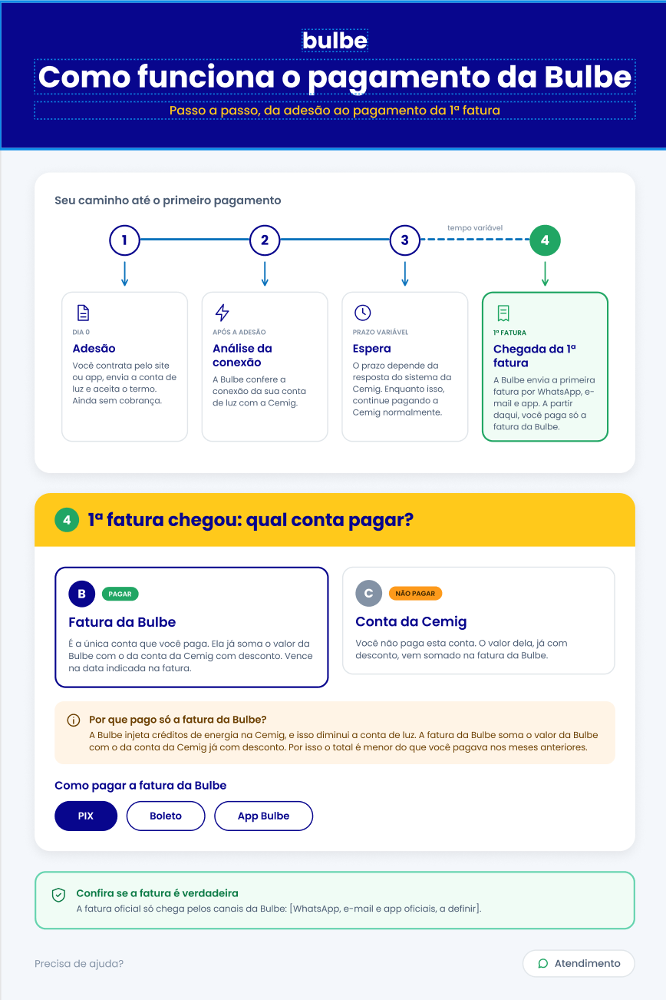
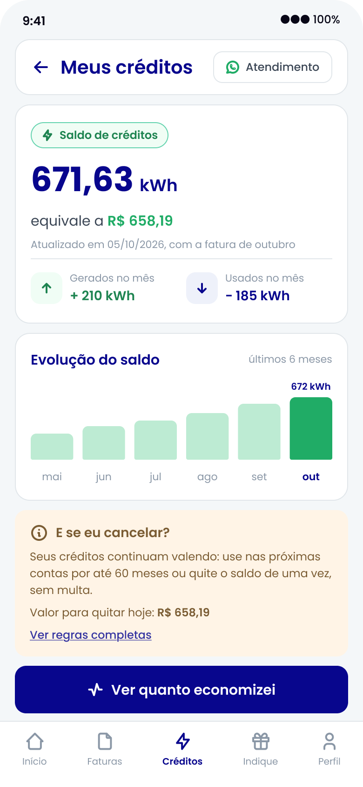
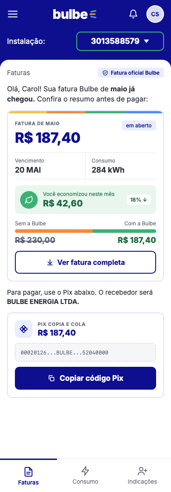

# Wireframes

Guardem aqui as imagens exportadas dos wireframes (PNG ou JPG), uma por tela, e também a imagem do mapa de jornada (`jornada.png`).

Nomeie os arquivos de tela com o ID da história: `hu01-confirmar-contatos.png`.
Wireframe Historia de Usuario Paulo José - HU01

Wireframe Historia de Usuario Marina - HU02

Wireframe Historia de Usuario João Antonio - HU03

Wireframe Historia de Usuario Ricardo - HU04

Wireframe Historia de Usuario Carol Santos - HU05

